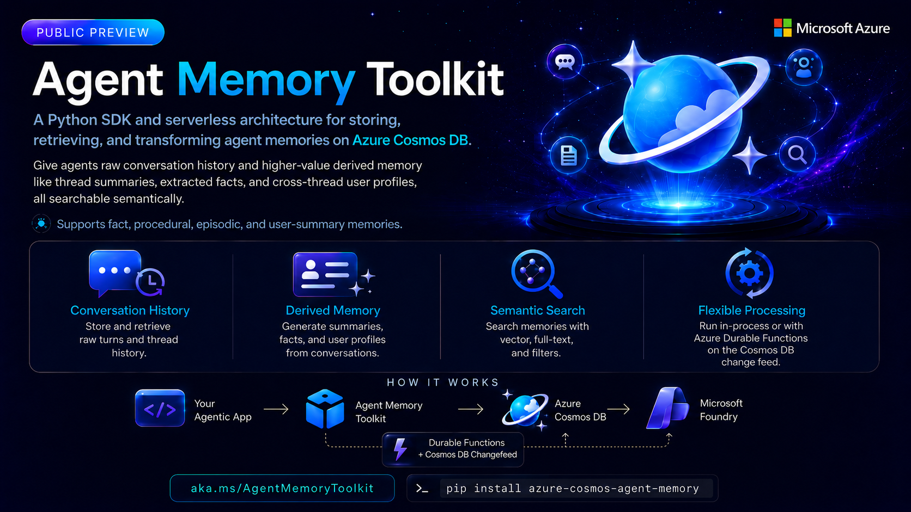

# Azure Cosmos DB Agent Memory Toolkit - Public Preview




[](https://opensource.org/licenses/MIT)
[](https://www.python.org/downloads/)
[](https://azure.microsoft.com/en-us/products/cosmos-db/)
[](https://twitter.com/AzureCosmosDB)
[](https://www.linkedin.com/showcase/azure-cosmos-db/)
[](https://www.youtube.com/@AzureCosmosDB)


Agent Memory Toolkit is a Python SDK for storing, retrieving, and transforming agent memories on Azure Cosmos DB. It gives your agent both raw conversation history and higher-value derived memory - thread summaries, extracted facts, episodes, procedures learned from what the user teaches and corrects, and cross-thread user profiles - all searchable semantically. The processing pipeline can run **in-process** (zero infra) or in a sibling **Azure Durable Function app** that watches the Cosmos DB change feed. Sync (`CosmosMemoryClient`) and async (`AsyncCosmosMemoryClient`) APIs are mirror-images of each other.


---

## Quickstart

### 1. Install

```bash
pip install azure-cosmos-agent-memory

# With dev/test dependencies (from a checkout)
pip install ".[dev]"
```

### 2. Provision Azure resources

The toolkit needs a Cosmos DB account, an Azure OpenAI / AI Foundry deployment, and (optionally for the remote processor) an Azure Function app. Pick whichever path matches your situation:

**Option A - One-command provision (`azd up`).** Creates everything from scratch - Cosmos + AI Foundry + Function app (Flex Consumption, idle cost ≈ $0) + UAMI + RBAC - and writes a working `.env` to `.azure/<env>/.env`:

```bash
# Prereqs: az + azd installed; subscription with quota for gpt-4o-mini
# and text-embedding-3-large in your chosen region (default: eastus2,
# also supported: swedencentral, westus3).

az login
azd auth login

azd env new memorytoolkit-dev
# Optional: pin a region other than eastus2
# azd env set AZURE_LOCATION swedencentral

azd up
# ~10 min later: Cosmos account + AI Foundry account + 2 model deployments
# (gpt-4o-mini, text-embedding-3-large) + UAMI + RBAC + Function app
# are provisioned. Outputs are written to .azure/memorytoolkit-dev/.env
```

The Function app is always provisioned but only used when you opt into `DurableFunctionProcessor` - it sits idle (and bills nothing) for in-process workloads.

Load the generated env vars and you're ready to use the SDK:

```bash
set -a && . ./.azure/memorytoolkit-dev/.env && set +a
```

To tear everything down later: `azd down --purge` (the `--purge` flag skips Cosmos / AI Foundry soft-delete so names are immediately reusable).

**Option B - Bring your own resources.** If you already have a Cosmos DB account and an AI Foundry / Azure OpenAI deployment, copy the env template and fill in the endpoints:

```bash
cp .env.template .env
# edit COSMOS_DB_ENDPOINT, AI_FOUNDRY_ENDPOINT, AI_FOUNDRY_EMBEDDING_DEPLOYMENT_NAME, AI_FOUNDRY_CHAT_DEPLOYMENT_NAME
```

> For the Durable Function app counter-trigger settings, Bicep module reference, RBAC scopes, and the SDK-only escape hatch (`DEPLOY_FUNCTION_APP=false`) - see **[`infra/README.md`](infra/README.md)**.

### 3. Use the SDK

```python
import os, uuid
from dotenv import load_dotenv
from azure.cosmos.agent_memory import CosmosMemoryClient

load_dotenv()

memory = CosmosMemoryClient(
    cosmos_endpoint=os.environ["COSMOS_DB_ENDPOINT"],
    cosmos_database=os.getenv("COSMOS_DB_DATABASE", "ai_memory"),
    cosmos_container=os.getenv("COSMOS_DB_MEMORIES_CONTAINER", "memories"),
    ai_foundry_endpoint=os.environ["AI_FOUNDRY_ENDPOINT"],
    embedding_deployment_name=os.getenv("AI_FOUNDRY_EMBEDDING_DEPLOYMENT_NAME", "text-embedding-3-large"),
    chat_deployment_name=os.getenv("AI_FOUNDRY_CHAT_DEPLOYMENT_NAME", "gpt-4o-mini"),
    use_default_credential=True,
    # processor=InProcessProcessor()   # implicit default
)
memory.connect_cosmos()  # auto-creates database + containers if missing

USER, THREAD = "user-001", str(uuid.uuid4())

# Add raw turns to a conversation
memory.upsert_memory(user_id=USER, thread_id=THREAD, role="user", content="I love Cosmos DB.")
memory.upsert_memory(user_id=USER, thread_id=THREAD, role="assistant", content="It is fantastic.")

# Run the processing pipeline (thread summary + fact extraction + user summary)
memory.process_now(user_id=USER, thread_id=THREAD)

# Search semantically across the stored memory
hits = memory.search_cosmos(user_id=USER, query_text="Cosmos DB preferences", top=5)
for h in hits:
    print(h["memory_type"], "-", h["content"][:80])

# Retrieve the cross-thread user profile
print(memory.get_user_summary(user_id=USER))
```

> Async API is identical - just `await` each call:
> ```python
> from azure.cosmos.agent_memory.aio import AsyncCosmosMemoryClient
> ```

### 4. Run a sample

```bash
python Samples/Quickstarts/quickstart_cosmos.py
```

See [`Samples/`](Samples/) for end-to-end scenarios (chat memory, RAG, multi-agent, customer support, remote processor).

---

## Concepts in 60 seconds

| Concept                   | What it is                                                                             | API                                                      |
|---------------------------|----------------------------------------------------------------------------------------|----------------------------------------------------------|
| **Turn**                  | One message (user or assistant) - the raw conversation atom                            | `upsert_memory(...)`, `add_local(...)`                   |
| **Thread summary**        | LLM-generated, incrementally updated rollup of a single thread                         | `generate_thread_summary(...)`                           |
| **Fact**                  | Discrete, independently searchable assertion extracted from turns                      | `extract_memories(...)`                                  |
| **Episodic**              | Bounded experience: situation → action → outcome, with lessons (90-day TTL)            | `extract_episodes(...)`                                  |
| **Procedural**            | Instruction, habit or skill learned from what the user teaches, corrects and practices | `synthesize_procedural(...)`, `retrieve_procedures(...)` |
| **Standing instructions** | The user's active, always-applicable procedures, compiled for a system prompt          | `build_procedural_context(...)`                          |
| **User summary**          | Cross-thread profile of what's known about a user                                      | `generate_user_summary(...)`, `get_user_summary(...)`    |
| **Search**                | Vector + full-text + filter over `fact` / `episodic` / `procedural`; optional slots    | `search_cosmos(...)`                                     |
| **Reconcile**             | Fold duplicate facts, combine facts about one thing, retire contradicted facts         | `reconcile(...)`                                         |
| **Process now**           | Run the full pipeline (summary → facts → reconcile → procedures → user profile)        | `process_now(...)`, `process_now_and_wait(...)`          |

AgentMemoryToolkit uses 3-container Cosmos topology, all partitioned by hierarchical `(user_id, thread_id)` keys:

| Container            | Holds                                      | Notes                             |
|----------------------|--------------------------------------------|-----------------------------------|
| `memories_turns`     | raw `turn` documents                       | append-only conversation timeline |
| `memories`           | `fact`, `episodic`, `procedural` documents | vector + full-text retrieval path |
| `memories_summaries` | thread and user summaries                  | latest-summary point/read path    |

### Memory Type Taxonomy

Each pipeline step writes one kind of derived memory. Every extracted fact carries a top-level `confidence` (0.0–1.0) so retrieval can suppress weakly-grounded extractions.

| Type       | Meaning                                                                       | Written by              | Storage type        | TTL     |
|------------|-------------------------------------------------------------------------------|-------------------------|---------------------|---------|
| Fact       | Declarative knowledge ("user prefers dark mode")                              | `extract_memories`      | `type="fact"`       | none    |
| Episodic   | Past experience: situation → action → outcome, with lessons                   | `extract_episodes`      | `type="episodic"`   | 90 days |
| Procedural | How the assistant should act for this user ("always confirm before deleting") | `synthesize_procedural` | `type="procedural"` | none    |

#### Confidence Scale

| Range   | Meaning                                            |
|---------|----------------------------------------------------|
| 0.9–1.0 | Directly stated and unambiguous                    |
| 0.7–0.9 | Clearly implied, no contradicting evidence         |
| 0.5–0.7 | Inferred from context - plausible but not explicit |
| < 0.5   | Speculative - likely should not be extracted       |

Filter at retrieval time:

```python
results = memory.search_cosmos("user preferences", user_id="u1", min_confidence=0.7)
high_conf_facts = memory.get_memories(user_id="u1", memory_types=["fact"], min_confidence=0.7)
```

#### Fact fields and extraction context

`extract_memories` runs `extract_memories-v3.prompty` by default. Besides `content`, `salience`, `confidence` and `metadata.category` (`preference`, `requirement`, `biographical` or `other`), each fact records:

- `assertion` - how the conversation put the fact forward: `stated`, `decided`, `suggested`, `observed`, `directive` (the user told the assistant how to act in future) or `correction` (the user corrected how the assistant did something). Only the user can direct or correct.
- `subject`, `attribute`, `entities` - what the fact is about, the single-valued property it gives a value of (`home city`), and the names it mentions (at most 12).
- `source_turn_ids` - the turns it came from.

The prompt also reads, as context only, up to 6 earlier turns of the thread, the thread summary (when it is older than the new turns) and the user's 15 nearest stored facts, so a reply such as "yes, do that" is written out in full and what is already stored is not restated. Facts still come only from the new turns. Set `AMT_EXTRACT_MEMORIES_PROMPT=extract_memories-v2.prompty` (or `extract_memories.prompty` for v1) to select an earlier prompt, which reads no context and records no `assertion`, `subject`, `attribute` or `entities`.

#### Procedural memory

Procedures are learned from evidence, not copied from one message. `synthesize_procedural` reads the behavioral facts and episode lessons written since its last run, and a procedure's `status` follows from the evidence it has gathered:

| `procedure_kind` | Learned from                                                                   | Becomes `active` when                                                                                              |
|------------------|--------------------------------------------------------------------------------|--------------------------------------------------------------------------------------------------------------------|
| `instruction`    | The user taught the assistant how to act in future ("always ...", "never ...") | the user taught or corrected it                                                                                    |
| `habit`          | The user corrected the assistant, or chose the same way repeatedly             | the user corrected the assistant, or the user's own facts or successful episodes support it on two different dates |
| `skill`          | A method of two or more steps that worked in practice                          | it succeeded in episodes on two different dates, or the user endorsed it                                           |

A habit's two dates count only facts the user stated and episodes with a successful or partially successful outcome: facts the assistant stated, and failed episodes, do not. A skill's two successes are episodes with a successful or partially successful outcome. Anything else stays a `candidate`, which search and prompt injection do not show. A procedure `applies` either `always` (nearly every interaction: language, tone, format) or `when` its activation conditions match, and may carry a `valid_until` date. `build_procedural_context(user_id)` returns the active, unexpired `always` rules as a system-prompt block, and `task=` adds the nearest situational rule:

```python
print(memory.build_procedural_context(USER, task="Review this pull request"))
# # Standing instructions from the user
# - Reply in Spanish.
# - Keep answers under 150 words.
#
# ## Apply only when the situation matches
# - When reviewing code for the user: Include a suggested fix with every review comment.
```

The pass runs after each reconcile (`PROCEDURAL_SYNTHESIS_AUTO`) or on demand with `synthesize_procedural(user_id)`. When an active situational procedure holds a directive or correction fact it cites, that fact is retired into the procedure, so the rule is stored and retrieved once.

#### Search slots

A plain search can fill `top_k` with topically close facts and miss a standing preference or a relevant procedure. `preference_slot=True` and `procedure_slot=True` reserve a place inside `top_k` for the user's best-matching preference fact and best-matching active situational procedure, found by vector similarity with the search's own filters (the procedure slot ignores `role`, `tags_all`, `tags_any`, `min_salience` and `min_confidence`, which no procedure can meet). An empty slot takes the next ranked result, and a slotted result carries `retrieval={"rank": ..., "slot": "preference" | "procedure" | "backfill"}`:

```python
hits = memory.search_cosmos(
    "Plan a weekend in Lisbon", user_id=USER, top_k=5, preference_slot=True, procedure_slot=True
)
```

`search_cosmos` always hides procedures that are not `active` or are past `valid_until`.

#### Secret redaction

Every write through the store or the pipeline, raw turns included, is scanned for credentials with a fixed format: private keys, Azure account keys and connection strings, SAS signatures, JWTs, Bearer and Basic authorization values, OpenAI, GitHub and AWS keys, and passwords inside URLs. Each match is replaced with `[REDACTED-SECRET]` before the text is embedded or stored, and the record is tagged `sys:secret` (`metadata.classification="secret"`). Credentials without a fixed format, such as `password: hunter2`, are left to the memory-writing prompts, which forbid storing them.

### Memory Reconciliation

`reconcile(user_id, n=50)` (on the public client; underlying pipeline method is `PipelineService.reconcile_memories`) keeps a user's fact pool clean in two passes, duplicates first and then contradictions:

1. **Duplicates, without losing detail.** Each fact written since the last pass is compared with its nearest active facts (cosine similarity ≥ 0.85) in one model call. A fact is retired into another (`supersede_reason="duplicate"`) only when the two state the same claim or one contains the other, the model lists nothing that would be lost, and a numbers / names / negation check agrees. The survivor keeps its content verbatim and lists the retired fact in `merged_from`. The pass also combines facts about one specific thing that each hold details the others lack into one verified fact (tagged `sys:combined`), and retires its sources with `supersede_reason="combined"`.
2. **Contradictions.** A single LLM pass over the `n` most-recent active facts soft-deletes each loser with `supersede_reason="contradict"`.

The pass returns `kept`, `merged` (duplicates retired), `contradicted`, and `checked`, `compared`, `vetoed`, `combined`, `synthesized`, `combine_groups` and `combine_failed` for the duplicate pass. Search hides retired records and `get_memory_history()` returns them; deleting a fact or procedure with `delete_memory()` also deletes the records retired into it. See [Docs/concepts.md](Docs/concepts.md#memory-reconciliation) for details.

> **Cost note.** A pass makes one duplicate check per new fact that has close neighbours (at most `n`, default 50, hard cap 500), up to four calls per combine group (write, check, and one retry of each), and one contradiction call over the `n` most-recent facts. With auto-trigger it fires every `FACT_EXTRACTION_EVERY_N × DEDUP_EVERY_N` turns per user, with `n` taken from `DEDUP_POOL_SIZE`. To bound LLM cost: raise `DEDUP_EVERY_N` (reconcile fires every Nth extraction, so a *higher* N means *less often*), lower `DEDUP_POOL_SIZE` (fewer new facts checked per pass; the rest wait for the next one), or override `n` per call when invoking `reconcile()` directly. In the Function App, `ACTIVITY_TIME_BUDGET_SECONDS` (default 240) stops a pass from starting model calls near the function timeout, and the next pass continues where it stopped.

| `MemoryRecord` field | Meaning                                                                                               |
|----------------------|-------------------------------------------------------------------------------------------------------|
| `content_hash`       | SHA-256 of normalized content; identical facts in a thread are skipped at write time                  |
| `supersede_reason`   | `"contradict"`, `"duplicate"`, `"combined"` or `"procedure"` (None for live records)                  |
| `superseded_at`      | ISO timestamp when the supersede happened (None for live records)                                     |
| `superseded_by`      | Id of the record that replaced this one                                                               |
| `merged_from`        | Ids of the records retired into this fact (duplicates it absorbed, or the sources of a combined fact) |

### Auto-trigger (per-turn extraction)

By default, the **InProcess processor** runs each pipeline step independently as its own threshold trips inside `push_to_cosmos()`:

| Env var                        | Default             | Step that fires                                                                                                                                                     | Async behavior                      |
|--------------------------------|---------------------|---------------------------------------------------------------------------------------------------------------------------------------------------------------------|-------------------------------------|
| `FACT_EXTRACTION_EVERY_N`      | `2` (every 2 turns) | `process_extract_memories`                                                                                                                                          | scheduled via `asyncio.create_task` |
| `DEDUP_EVERY_N`                | `5`                 | `process_reconcile` (fires every Nth extract → effectively every `FACT_EXTRACTION_EVERY_N × DEDUP_EVERY_N` turns)                                                   | scheduled via `asyncio.create_task` |
| `DEDUP_POOL_SIZE`              | `50`                | pool size (`n`) passed to `process_reconcile` from the auto-trigger: new facts checked per duplicate pass and facts in the contradiction pass; hard-capped at `500` | n/a (per-call)                      |
| `PROCEDURAL_SYNTHESIS_AUTO`    | `true`              | `synthesize_procedural` after each reconcile; `false` turns the chained procedure pass off                                                                          | scheduled via `asyncio.create_task` |
| `THREAD_SUMMARY_EVERY_N`       | `10`                | `process_thread_summary`                                                                                                                                            | scheduled via `asyncio.create_task` |
| `USER_SUMMARY_EVERY_N`         | `20`                | `process_user_summary`                                                                                                                                              | scheduled via `asyncio.create_task` |
| `ACTIVITY_TIME_BUDGET_SECONDS` | `240`               | **Function App only**: seconds a reconcile or procedure activity keeps starting model calls (minimum `30`; keep it below `functionTimeout`)                         | n/a                                 |

Each `*_EVERY_N=0` disables only that step. Reconcile is gated independently of extract because it makes the most model calls per run (a duplicate check per new fact, combining, and the contradiction pass), and running it on every extract slammed AI Foundry. The Durable backend uses the same defaults via the change-feed function app; bump `FACT_EXTRACTION_EVERY_N` / `DEDUP_EVERY_N` for cost-sensitive, higher-volume production traffic. Calling `process_now()` is normally redundant - it remains as an explicit "process now" hook for tests, manual workflows, and operators who set every threshold to `0`.

The async client (`AsyncCosmosMemoryClient.push_to_cosmos`) does **not** await the auto-trigger; it schedules it as a background `asyncio.Task` so the write call returns as soon as the Cosmos upserts complete. Background failures are surfaced via `logger.warning` (search for `"Background auto-trigger task failed"`).

#### Backend exclusivity (`MEMORY_PROCESSOR_OWNER`)

Both the SDK auto-trigger and the function-app change-feed processor write into the same `counter` container. If you accidentally point an `InProcessProcessor` at a Cosmos container that already has a function app attached, both backends will run the pipeline on the same writes - double extraction, double dedup, double counters.

Set the env var on **both sides** to make ownership explicit:

| `MEMORY_PROCESSOR_OWNER` | SDK behavior                      | Function-app behavior                  |
|--------------------------|-----------------------------------|----------------------------------------|
| _unset_ (default)        | runs auto-trigger                 | runs orchestrator (today's behavior)   |
| `inprocess`              | runs auto-trigger                 | change-feed trigger skips batch + logs |
| `durable`                | auto-trigger logs warning + skips | runs orchestrator                      |

The default (unset) preserves backward compatibility. For any production deployment we recommend setting it on both sides so a misconfiguration produces a loud log line instead of silent double-work.

> **Advisory, not enforced.** `MEMORY_PROCESSOR_OWNER` is operator-configured exclusivity, not a server-side lock. Each backend reads its own env var; if the SDK is set to `inprocess` but the FA forgets to set `durable` (or vice versa), both still run. As a backstop, every counter write stamps `last_owner=<this backend>` on the doc - when the SDK observes a counter previously written by `durable` (or vice versa), it logs a one-shot `WARN` so misconfiguration surfaces in logs without spamming. Treat this as a configuration audit signal, not a hard guarantee.

---

## Two processor flavors

Pick at construction time via the `processor=` kwarg.

|                          | `InProcessProcessor` (default)    | `DurableFunctionProcessor`                           |
|--------------------------|-----------------------------------|------------------------------------------------------|
| Infra                    | None - just `pip install`         | Sibling Azure Function app                           |
| Best for                 | Prototypes, low TPS, single-agent | Fleet / multi-agent / high TPS                       |
| `process_now()`          | Synchronous, returns when done    | No-op (work runs async on change feed)               |
| `process_now_and_wait()` | Returns immediately after flush   | Polls until summary visible (RU-costly; tests/demos) |

```python
from azure.cosmos.agent_memory import CosmosMemoryClient, DurableFunctionProcessor

memory = CosmosMemoryClient(..., processor=DurableFunctionProcessor())
```

`DurableFunctionProcessor` is a thin marker - there is no SDK→Function HTTP call. The SDK just writes turns; the deployed Function app picks them up via the Cosmos change feed. Counter-based trigger configuration and Bicep module reference live in [`infra/README.md`](infra/README.md).

---

### Architecture overview

```
+--------------------------+
|        Agent app         |
+------------+-------------+
             |
             v
+--------------------------+      +--------------------------+
| Agent Memory Toolkit     | <--> | Microsoft Foundry        |
| Python sync/async SDK    |      | LLMs + embeddings        |
+------------+-------------+      +------------+-------------+
             ^                                 ^
             |                                 |
             v                                 v
+--------------------------+      +--------------------------+
| Azure Cosmos DB          | <--> | Azure Durable Functions  |
| memories + search        |      | optional processing      |
+--------------------------+      +--------------------------+
```

---

## Public API reference

| Symbol                               | Module                          | Purpose                                                                                  |
|--------------------------------------|---------------------------------|------------------------------------------------------------------------------------------|
| `CosmosMemoryClient`                 | `azure.cosmos.agent_memory`     | Sync client - local CRUD, Cosmos DB I/O, processing                                      |
| `AsyncCosmosMemoryClient`            | `azure.cosmos.agent_memory.aio` | Async mirror                                                                             |
| `MemoryProcessor`                    | `azure.cosmos.agent_memory`     | Protocol that any processor backend implements                                           |
| `InProcessProcessor`                 | `azure.cosmos.agent_memory`     | Default backend - runs the pipeline in-process                                           |
| `DurableFunctionProcessor`           | `azure.cosmos.agent_memory`     | Marker backend - work runs in sibling Function app via change feed                       |
| `client.process_now()`               | -                               | Run the pipeline for recent turns (in-process) or no-op (remote)                         |
| `client.process_now_and_wait()`      | -                               | Opt-in poll until processing completes; useful for tests/demos with the remote backend   |
| `client.search_cosmos()`             | -                               | Vector + full-text search; `preference_slot` / `procedure_slot` reserve result slots     |
| `client.reconcile()`                 | -                               | Fold duplicate facts, combine facts about one thing, retire contradicted facts           |
| `client.build_procedural_context()`  | -                               | Standing instructions (plus the nearest situational rule with `task=`) as a prompt block |
| `MemoryRecord`, `MemoryType`, `Role` | `azure.cosmos.agent_memory`     | Pydantic models / enums                                                                  |

Async equivalents (`AsyncInProcessProcessor`, `AsyncDurableFunctionProcessor`) live in `azure.cosmos.agent_memory.aio`.

---

## Documentation

- **[Docs/concepts.md](Docs/concepts.md)** - Memory types, threads, roles, embeddings, search slots, processing pipeline, reconciliation
- **[Docs/design_patterns.md](Docs/design_patterns.md)** - Integration patterns for chat apps and multi-agent systems
- **[Docs/public_api.md](Docs/public_api.md)** - Client methods and options, fact and procedure fields, secret redaction
- **[Docs/operations.md](Docs/operations.md)** - TTLs and runtime settings (thresholds, reconcile, procedures, extraction prompt)
- **[Docs/local_testing.md](Docs/local_testing.md)** - Prerequisites, environment setup, running locally, debugging
- **[Docs/azure_testing.md](Docs/azure_testing.md)** - Azure deployment, RBAC, cloud validation
- **[infra/README.md](infra/README.md)** - `azd` deployment, Bicep modules, RBAC, counter-trigger tuning, SDK-only mode
- **[Docs/troubleshooting.md](Docs/troubleshooting.md)** - Common issues and resolutions for setup, auth, Cosmos DB, embeddings, Durable Functions, vector search, change feed, etc.

---

## Project structure

```
azure/cosmos/agent_memory/   Python SDK (sync + aio mirror)
  processors/           MemoryProcessor Protocol + InProcess/Durable backends
function_app/           Sibling Azure Durable Function app
infra/                  Bicep modules + main.bicep for `azd up`
azure.yaml              `azd` config - provisions Cosmos + AI Foundry + Function app
Samples/                Categorized demo notebooks + sample scripts
Docs/                   Conceptual + operational docs
tests/                  Unit + integration tests (pytest)
```

---

## Migration notes

- **`azure.cosmos.agent_memory.processing.ProcessingClient` is removed.** Drop the import and call `client.process_now()` (or `client.process_now_and_wait()`) instead. Same for the async `AsyncProcessingClient`.
- **New `processor=` kwarg.** Defaults to `InProcessProcessor()` - existing code keeps its current behavior with no edits.
- **`adf_endpoint` / `adf_key` constructor kwargs are gone.** The SDK no longer makes HTTP calls to the Function app at runtime; the Function app reads from the Cosmos change feed.
- **Procedural memory is reshaped, with no migration.** `procedure_kind` is `instruction`, `habit` or `skill`; `scope_type` / `scope_value`, `ProcedureScopeType` and the `scope_*` arguments of `retrieve_procedures()` are gone; `build_procedural_context()` returns only standing (`applies="always"`) rules, plus the nearest situational rule when `task=` is given. Procedures written by earlier betas are not shown or migrated. See [CHANGELOG.md](CHANGELOG.md).
- **Structured logs: `exc_msg` is now `exc_detail`.** It describes an exception by type, error code, status and code location and never quotes its message. Failed Function App activities likewise report only `<code> (<ExcType>)` to Durable Functions.

## Trademark notice
Trademarks This project may contain trademarks or logos for projects, products, or services. Authorized use of Microsoft trademarks or logos is subject to and must follow Microsoft’s Trademark & Brand Guidelines. Use of Microsoft trademarks or logos in modified versions of this project must not cause confusion or imply Microsoft sponsorship. Any use of third-party trademarks or logos are subject to those third-party’s policies.
